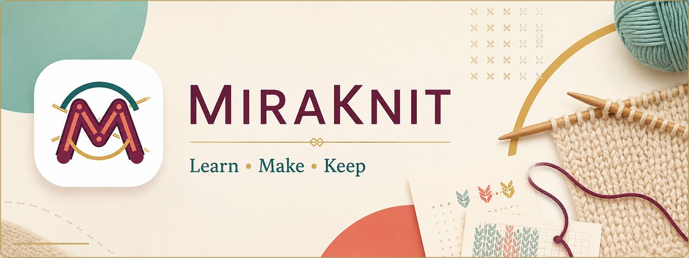
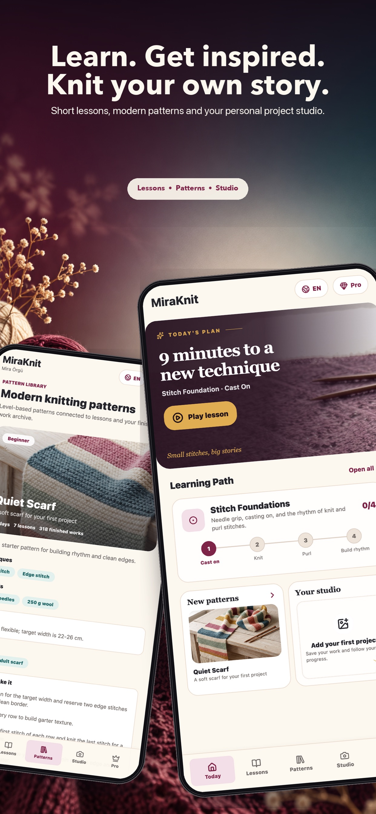
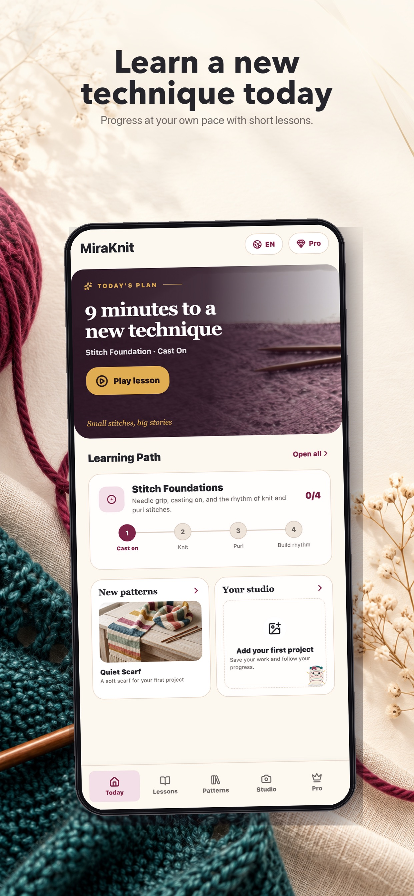
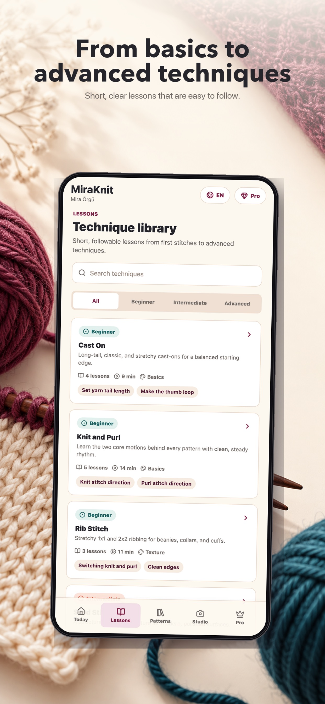
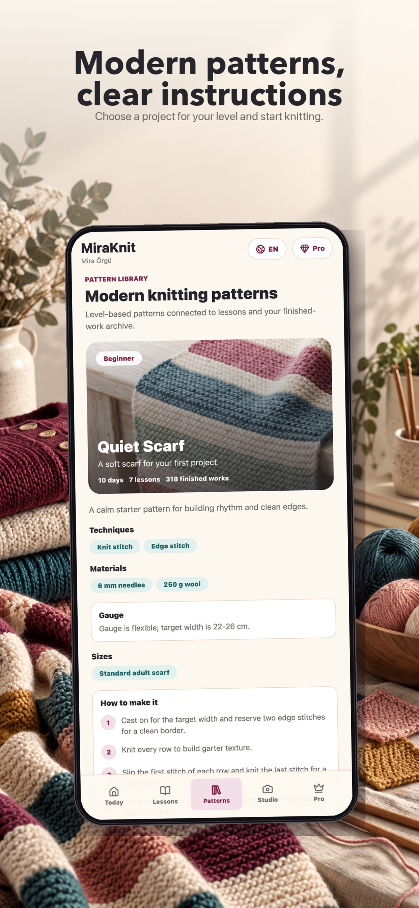
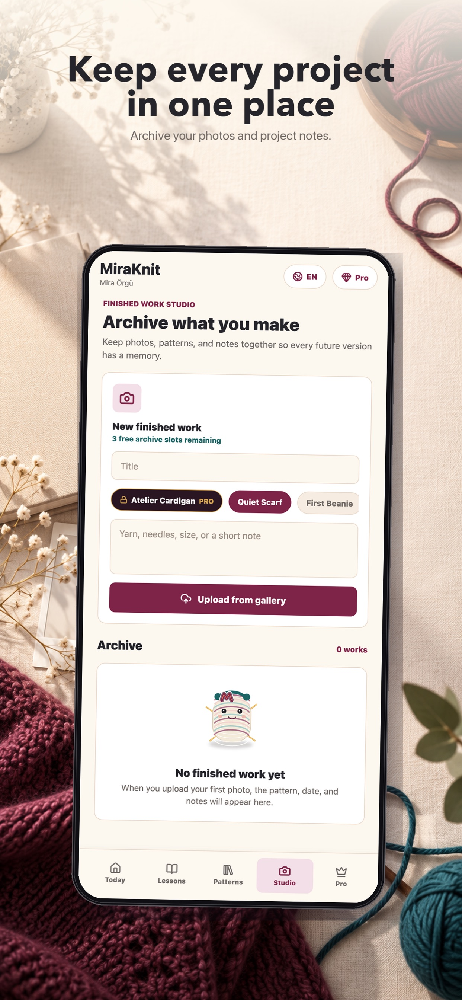
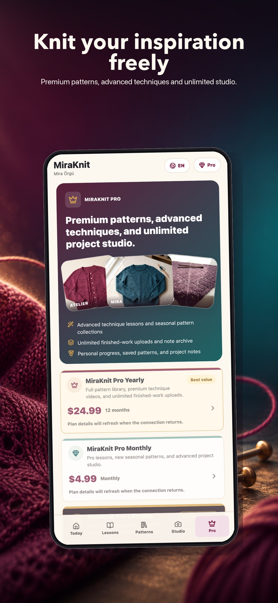

<h1 align="center">MiraKnit</h1>

  <strong>Learn knitting, follow modern patterns, and preserve every finished piece.</strong> 
  A calm, structured knitting studio designed for iPhone.

  
  
  
  

  

## Available now

MiraKnit **1.0.2** is live on the App Store with support for 13 languages. [Download MiraKnit on the App Store →](https://apps.apple.com/app/id6793510512)

## Product at a glance

| | |
| --- | --- |
| **Purpose** | Turn knitting practice into a clear learn–make–archive journey. |
| **Audience** | Beginners building confidence and experienced makers organizing projects. |
| **Core experience** | Short lessons, realistic patterns, progress tracking and a personal studio. |
| **Design direction** | Calm hierarchy, focused steps and visual previews that reduce cognitive load. |
| **Availability** | Live on the App Store · Version 1.0.2 |

## The MiraKnit flow

1. **Learn** — practise a technique with a short, focused lesson.
2. **Choose** — discover a modern pattern matched to your level.
3. **Make** — follow materials and project steps without losing context.
4. **Keep** — save the finished work with photos, yarn details and notes.

## Highlights

- Progressive technique lessons from beginner to advanced
- Modern pattern library with realistic project previews
- Materials, tools and prerequisite lessons for each pattern
- Progress tracking across active projects
- A lasting archive of finished handmade work
- MiraKnit Pro collections and advanced lessons
- 13 supported languages

## App Store previews

  
  
  
  
  
  

  
<strong>Türkçe App Store görselleri</strong>

   
  

## Türkçe

Mira Örgü; kısa dersleri, modern modelleri, ilerleme takibini ve tamamlanan işler arşivini tek bir sakin deneyimde birleştirir. Kullanıcı temel tekniklerden başlayabilir, seviyesine uygun projeyi seçebilir ve bitirdiği parçaları fotoğraf ve notlarla saklayabilir.

## Legal

- [Privacy Policy](https://sites.google.com/view/miraknit-legal/privacy-policy)
- [Terms of Use](https://sites.google.com/view/miraknit-legal/terms-of-use)

© 2026 MiraKnit. All rights reserved.
