

  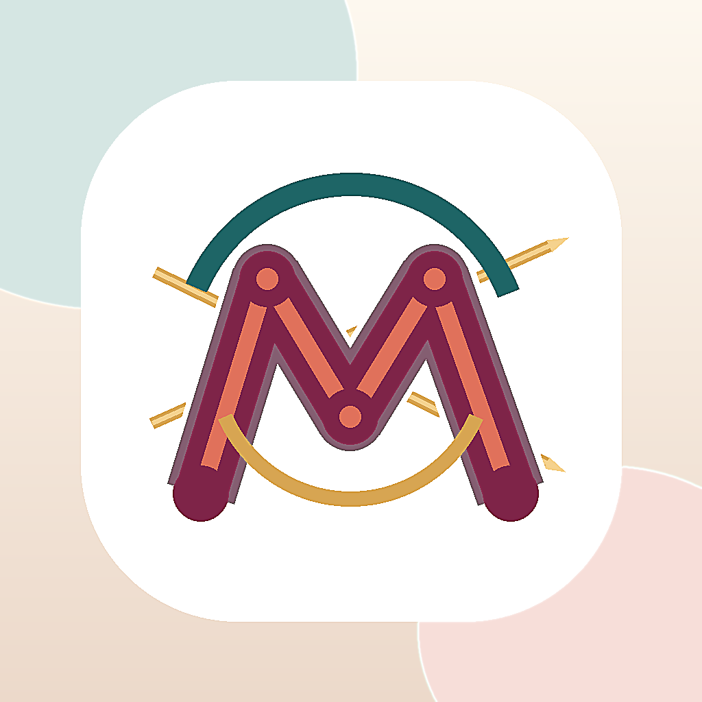

<h1 align="center">MiraKnit</h1>

  <strong>Learn knitting, follow modern patterns, and preserve every finished piece.</strong> 
  A calm, structured knitting studio designed for iPhone.

  <a href="#english">English</a> · <a href="#türkçe">Türkçe</a> · <a href="#app-store-previews">App Store Previews</a>

## English

MiraKnit is a premium knitting learning studio that brings lessons, modern patterns, progress tracking, and a personal project archive together in one focused experience.

It is designed for people who want more guidance than a simple row counter: start with the fundamentals, build confidence through short lessons, choose a project with realistic previews, and save the finished piece with photos and notes.

### What you can do

- Learn knitting through short, step-by-step technique lessons
- Follow a clear path from beginner skills to advanced techniques
- Explore a modern pattern library with realistic project previews
- Find the materials, tools, and lesson sequence for each pattern
- Save finished work with photos, yarn details, and personal notes
- Build a lasting personal archive of handmade projects
- Use the app in 13 supported languages

### The MiraKnit flow

1. **Learn** — practise a technique with a short, focused lesson.
2. **Choose** — discover a modern pattern that matches your level.
3. **Make** — follow the project one step at a time.
4. **Keep** — save the finished work and the story behind it.

## App Store Previews

### English

  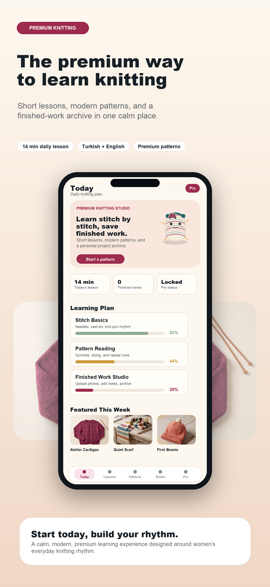
  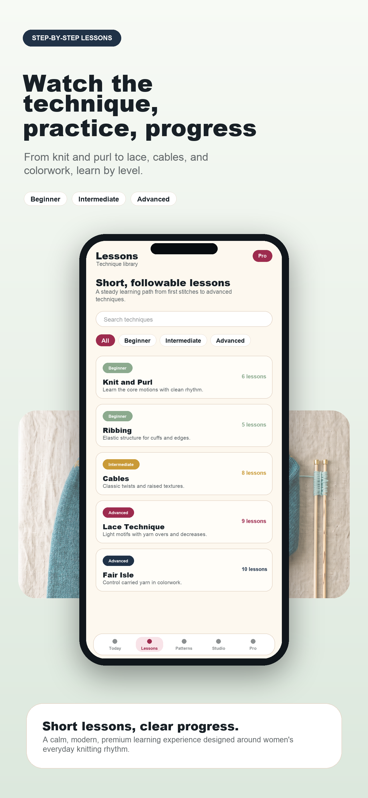
  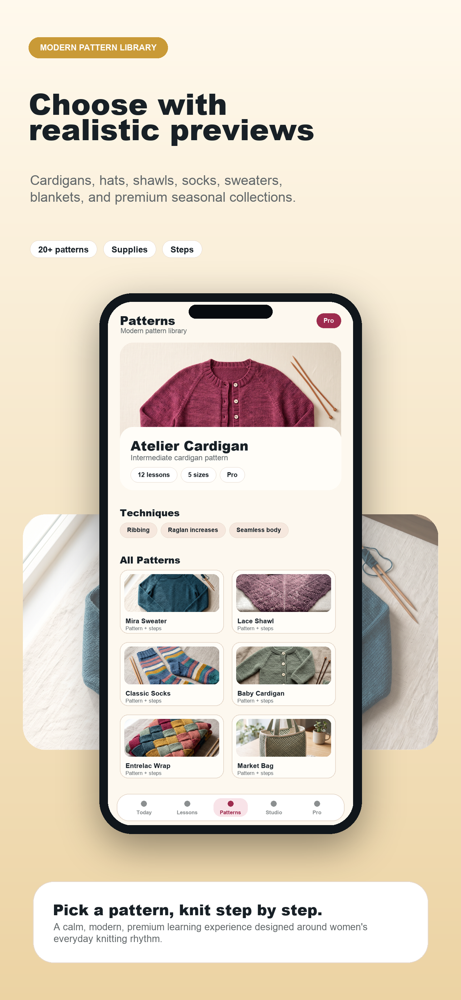
  
  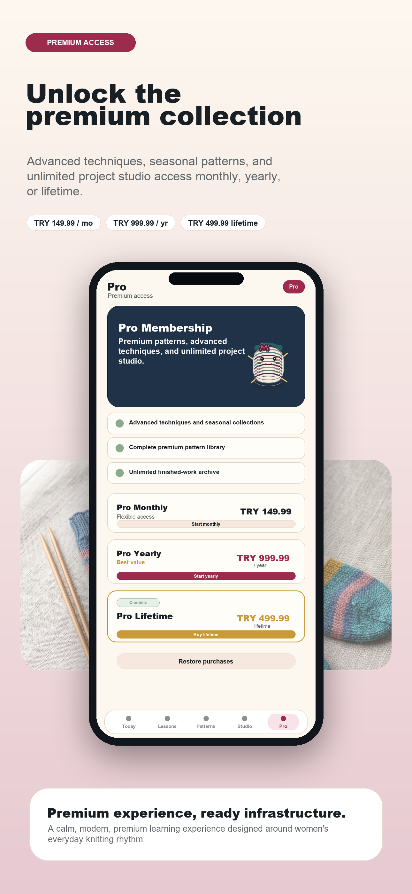

  
<strong>View the full English preview sheet</strong>

   
  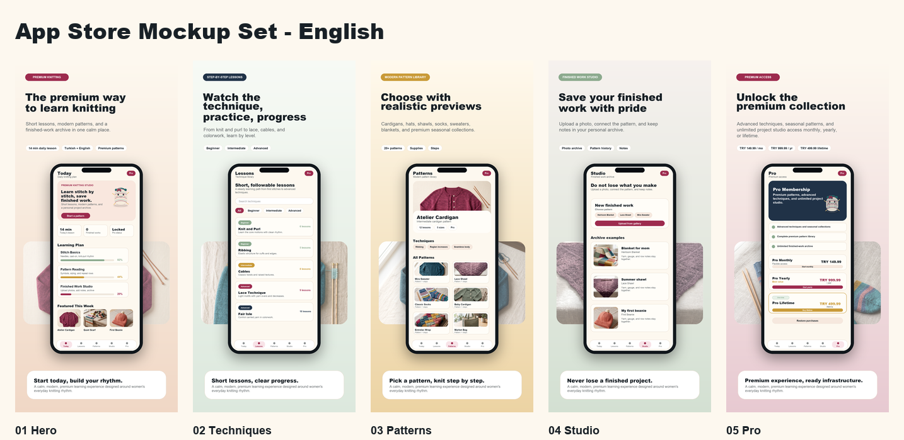

### Türkçe

  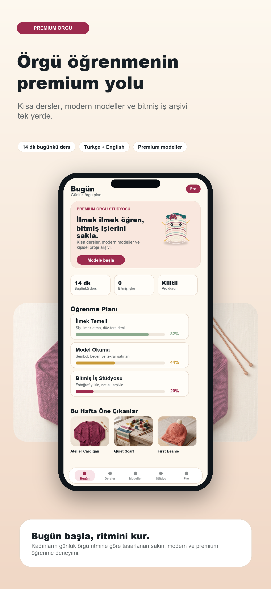
  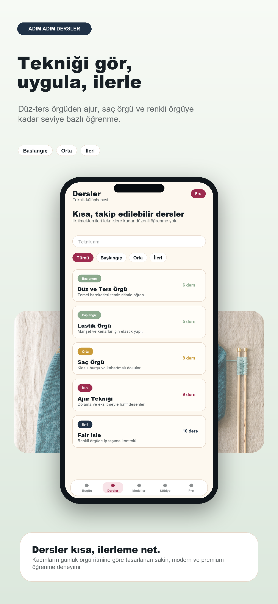
  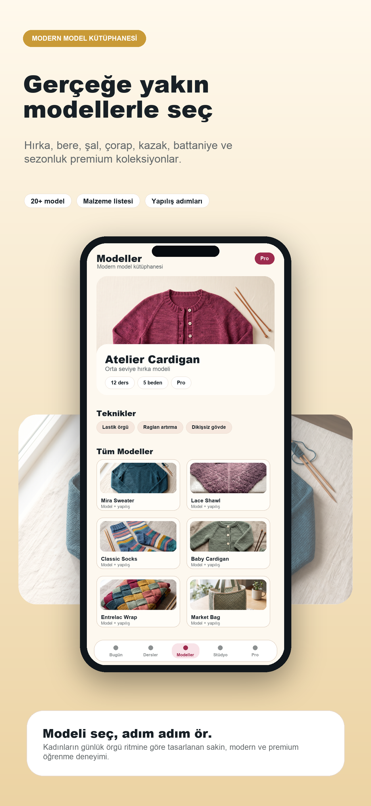
  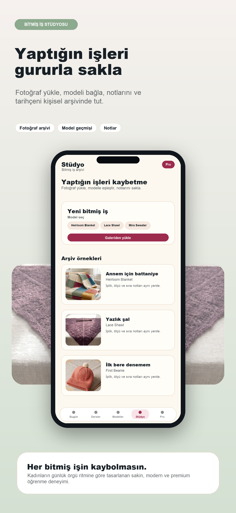
  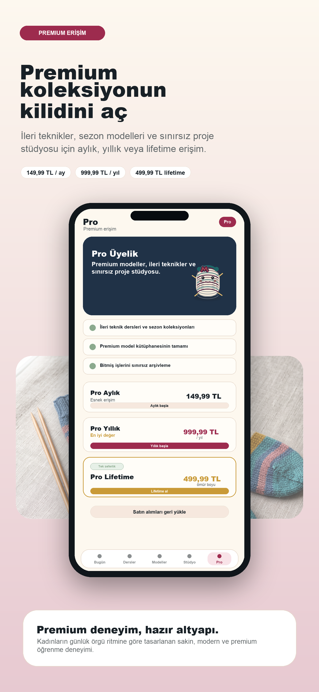

  
<strong>Türkçe görsel setinin tamamını görüntüle</strong>

   
  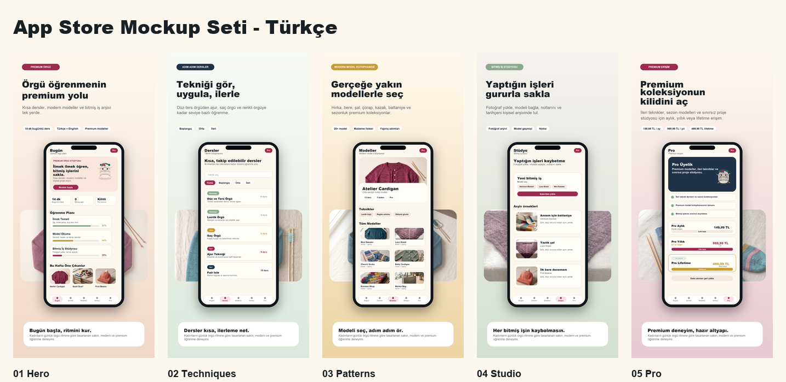

## Türkçe

Mira Örgü; kısa dersleri, modern modelleri, ilerleme takibini ve bitmiş işler arşivini tek bir sakin deneyimde birleştiren premium bir örgü öğrenme stüdyosudur.

Basit bir sıra sayacından daha fazlasını isteyenler için tasarlandı: temel teknikleri öğren, seviyene uygun bir model seç, adım adım ilerle ve tamamladığın işleri fotoğraf ve notlarla sakla.

### Öne çıkanlar

- Kısa ve adım adım örgü tekniği dersleri
- Başlangıçtan ileri seviyeye düzenli öğrenme yolu
- Gerçeğe yakın önizlemelere sahip modern model kütüphanesi
- Her model için malzeme, araç ve ders bilgileri
- Fotoğraf, iplik bilgisi ve notlarla bitmiş iş arşivi
- 13 dil desteği
- İleri dersler ve özel koleksiyonlar için MiraKnit Pro

## About this repository

This is MiraKnit's public product showcase. It contains product information and promotional visuals only; the production source code and private configuration are maintained separately.

MiraKnit and its original visual assets are © 2026 MiraKnit. All rights reserved.

### Legal

- [Privacy Policy](https://sites.google.com/view/miraknit-legal/privacy-policy)
- [Terms of Use](https://sites.google.com/view/miraknit-legal/terms-of-use)
